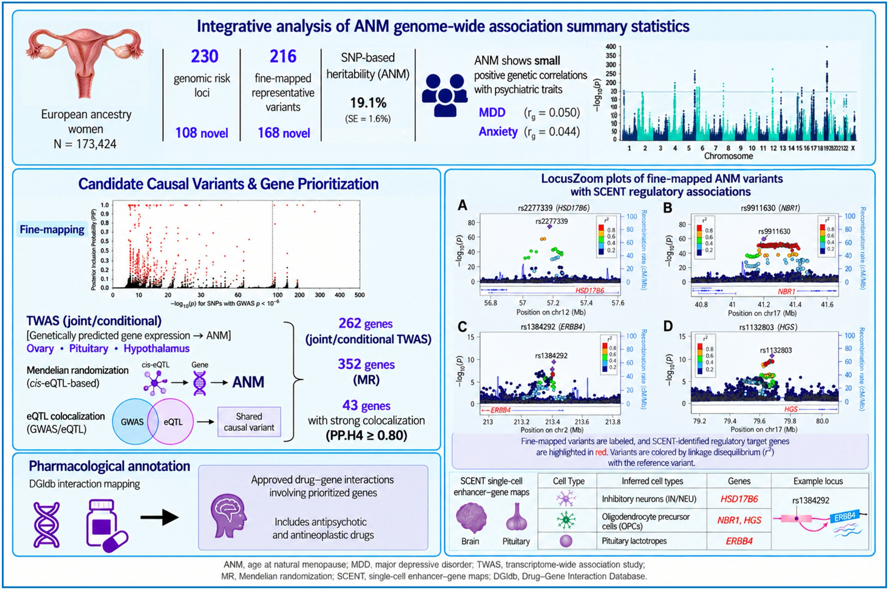

# Age at Natural Menopause: Integrative Functional Genomics



## Overview

This project integrates statistical genetics, functional genomics, and
single-cell regulatory analyses to investigate the genetic architecture and
biological mechanisms underlying age at natural menopause (ANM).

The analytical framework combines genomic risk-locus characterization,
Bayesian fine-mapping, multi-layer xQTL annotation, transcriptome-wide
association analysis (TWAS), Mendelian randomization (MR), colocalization,
and cell-type-specific regulatory mapping to prioritize candidate variants,
genes, tissues, and cellular mechanisms associated with reproductive aging.

Particular emphasis is placed on ovarian, brain, and pituitary regulatory
biology and on the genetic relationships between ANM and the neuropsychiatric
traits major depressive disorder (MDD) and anxiety (ANX).


## 🟣 SNP-Based Heritability and Genetic Correlations (LDSC)

SNP-based heritability and pairwise genetic correlations among
age at natural menopause (ANM), major depressive disorder (MDD),
and anxiety disorders (ANX) were estimated using linkage
disequilibrium score regression (LDSC).

Analyses used European-ancestry LD scores and regression weights
distributed with LDSC (`eur_w_ld_chr`).

### GWAS Summary Statistics Preparation and Munging

GWAS summary statistics were processed using LDSC's
`munge_sumstats.py` to standardize SNP identifiers, effect alleles,
association statistics, and sample sizes before heritability
and genetic correlation estimation.

All three analyses used the corresponding European-ancestry
GWAS summary statistics.

#### ANM

ANM summary statistics were obtained from the GWAS of
Ojavee et al. (2023), using the discovery sample of
173,424 women of European ancestry.

The GWAS effect estimates were derived from a Cox
proportional hazards model. Positive effect estimates
correspond to increased menopause hazard (earlier menopause).

The following command was used:

```bash
python munge_sumstats.py \
  --sumstats ANM_GWAS_input.txt \
  --snp rs_id \
  --a1 effect_allele \
  --a2 other_allele \
  --p p_value \
  --signed-sumstats beta,0 \
  --N 173424 \
  --out ANM_LDSC_corrected
```

The resulting file was:

`ANM_LDSC_corrected.sumstats.gz`

#### MDD

MDD summary statistics were obtained from the 2025
Psychiatric Genomics Consortium (PGC) European-ancestry
meta-analysis, excluding 23andMe data.

The combined European-ancestry dataset was used rather
than the EHR-only subset.

Variant-specific effective sample sizes (`NEFF`) were
used instead of assigning a single sample size to all SNPs.

```bash
python munge_sumstats.py \
  --sumstats MDD_GWAS_2025_clean.txt \
  --snp ID \
  --a1 EA \
  --a2 NEA \
  --p PVAL \
  --signed-sumstats BETA,0 \
  --N-col NEFF \
  --out MDD_LDSC_corrected
```

The resulting file was:

`MDD_LDSC_corrected.sumstats.gz`

#### ANX

ANX summary statistics were obtained from the
European-ancestry GWAS of major anxiety disorders
reported by Strom et al.

The GWAS provided odds ratios (ORs), which were
processed using `--signed-sumstats OR,1`.

During preprocessing, the effective sample-size field
used in the initial LDSC input was identified as
approximately half the full effective sample size
required for the analysis.

A corrected effective sample-size column was prepared:

`Neff_full = 2 × Neff_half`

The corrected values were stored in the `Neff_full`
column of the LDSC input file.

```bash
python munge_sumstats.py \
  --sumstats Anxiety_ANX2026_LDSC_input.txt \
  --snp SNP \
  --a1 A1 \
  --a2 A2 \
  --p P \
  --signed-sumstats OR,1 \
  --N-col Neff_full \
  --out ANX_LDSC_corrected
```

The resulting file was:

`ANX_LDSC_corrected.sumstats.gz`

**Important:** The ANX effective sample-size adjustment
is specific to the input data preparation used in this
analysis. It should not be applied automatically to
other GWAS datasets. The original effective sample-size
definition should be verified before reproducing this step.

### Heritability Estimation

Univariate LDSC was used to estimate SNP-based heritability.

For MDD and ANX, observed-scale heritability estimates
were converted to the liability scale using the following
parameters:

| Trait | Sample prevalence | Population prevalence | Reported scale |
|---|---:|---:|---|
| ANM | Not applicable | Not applicable | Observed |
| MDD | 0.50 | 0.15 | Liability |
| ANX | 0.50 | 0.20 | Liability |

The assumed sample prevalence of 0.50 represents a
balanced case-control equivalent associated with the
use of effective sample sizes. It does not imply that
the original GWAS samples contained equal numbers of
cases and controls.

The MDD population prevalence assumption follows
Adams et al. (2025), while the ANX prevalence
assumptions follow Strom et al.

### LDSC Heritability Commands

The following commands assume that LDSC is installed,
the munged GWAS summary statistics are available in
the working directory, and the European LD reference
files are stored in `eur_w_ld_chr/`.

#### ANM

```bash
python ldsc.py \
  --h2 ANM_LDSC_corrected.sumstats.gz \
  --ref-ld-chr eur_w_ld_chr/eur_w_ld_chr. \
  --w-ld-chr eur_w_ld_chr/eur_w_ld_chr. \
  --out ANM_h2
```

#### MDD

```bash
python ldsc.py \
  --h2 MDD_LDSC_corrected.sumstats.gz \
  --ref-ld-chr eur_w_ld_chr/eur_w_ld_chr. \
  --w-ld-chr eur_w_ld_chr/eur_w_ld_chr. \
  --samp-prev 0.5 \
  --pop-prev 0.15 \
  --out MDD_h2_liability
```

#### ANX

```bash
python ldsc.py \
  --h2 ANX_LDSC_corrected.sumstats.gz \
  --ref-ld-chr eur_w_ld_chr/eur_w_ld_chr. \
  --w-ld-chr eur_w_ld_chr/eur_w_ld_chr. \
  --samp-prev 0.5 \
  --pop-prev 0.20 \
  --out ANX_h2_liability
```

### SNP-Based Heritability Results

| Trait | SNP heritability | Standard error | Scale |
|---|---:|---:|---|
| ANM | 0.1909 | 0.0162 | Observed |
| MDD | 0.0603 | 0.0019 | Liability |
| ANX | 0.1022 | 0.0038 | Liability |

These estimates were obtained using the corrected
LDSC summary statistics.

The ANM estimate is based on Cox-model GWAS association
statistics and should not be interpreted directly as
the proportion of variance explained in menopause age
measured in years.

### Genetic Correlation Analysis

Bivariate LDSC was used to estimate genome-wide
pairwise genetic correlations among ANM, MDD, and ANX.

The same European-ancestry LD reference scores and
regression weights were used for all three comparisons.

#### ANM–MDD

```bash
python ldsc.py \
  --rg ANM_LDSC_corrected.sumstats.gz,MDD_LDSC_corrected.sumstats.gz \
  --ref-ld-chr eur_w_ld_chr/eur_w_ld_chr. \
  --w-ld-chr eur_w_ld_chr/eur_w_ld_chr. \
  --out ANM_MDD_rg
```

#### ANM–ANX

```bash
python ldsc.py \
  --rg ANM_LDSC_corrected.sumstats.gz,ANX_LDSC_corrected.sumstats.gz \
  --ref-ld-chr eur_w_ld_chr/eur_w_ld_chr. \
  --w-ld-chr eur_w_ld_chr/eur_w_ld_chr. \
  --out ANM_ANX_rg
```

#### MDD–ANX

```bash
python ldsc.py \
  --rg MDD_LDSC_corrected.sumstats.gz,ANX_LDSC_corrected.sumstats.gz \
  --ref-ld-chr eur_w_ld_chr/eur_w_ld_chr. \
  --w-ld-chr eur_w_ld_chr/eur_w_ld_chr. \
  --out MDD_ANX_rg
```

### Genetic Correlation Results

| Trait pair | Genetic correlation (rg) | SE | P-value |
|---|---:|---:|---:|
| ANM–MDD | 0.0499 | 0.0185 | 0.0071 |
| ANM–ANX | 0.0443 | 0.0220 | 0.0446 |
| MDD–ANX | 0.9074 | 0.0098 | < 0.00001 |

Because ANM GWAS effects were estimated on the menopause-hazard scale,
the weak positive genetic correlations for ANM–MDD (rg = 0.0499) and
ANM–ANX (rg = 0.0443) indicate positive genetic correlations between
MDD or ANX liability and menopause hazard, not later menopause age.
MDD and ANX exhibited a strong positive genetic correlation (rg = 0.9074).
These genetic correlations do not establish causal relationships.

After Bonferroni correction for three pairwise
comparisons (P < 0.0167), the ANM–MDD and MDD–ANX
correlations remained statistically significant.
The ANM–ANX correlation was nominally significant.

### Reproducibility Notes

- ANM heritability is reported on the observed scale.
- MDD and ANX heritability estimates are reported on
  the liability scale.
- MDD GWAS variant-specific effective sample sizes
  (`NEFF`) were used during munging.
- ANX effective sample sizes were prepared in the
  `Neff_full` column before munging.
- ANM effect estimates were derived from a Cox
  proportional hazards model. The direction of genetic
  correlations involving ANM must therefore be
  interpreted with respect to menopause hazard rather
  than menopause age directly.
- The MDD–ANX genetic covariance intercept was
  0.2652 (SE = 0.0089), consistent with possible
  sample overlap and/or correlated confounding.
- GWAS summary statistics and LD reference files
  must be obtained from their original sources,
  subject to applicable access conditions.
- Input filenames and reference directories in the
  commands above are illustrative relative paths;
  they should be adjusted to the local installation.
  

## 🟣 ANM Approximate Bayes Factor Fine-Mapping

Fine-mapping of ANM-associated genomic risk loci was performed using an
approximate Bayes factor (ABF) approach implemented with `coloc::finemap.abf`.

For each FUMA-defined genomic risk locus, all eligible ANM GWAS variants within
the locus boundaries were analyzed using GWAS effect estimates, standard errors,
minor allele frequencies, and the ANM discovery sample size. SNP-level posterior
inclusion probabilities (PIPs) were calculated under a single-causal-variant
model using a prior probability of `1 × 10^-4` per SNP.

Variants were ranked by PIP to construct locus-specific 90% credible sets.
The highest-PIP SNP was identified for each successfully fine-mapped locus, and
variants with `PIP > 0.03` were additionally retained for downstream
prioritization.

### Fine-Mapping Script

#### `ANM_ABF_finemapping.R`

This script performs the complete ANM ABF fine-mapping workflow, including:

- extraction of variants within FUMA-defined genomic risk loci;
- calculation of ABF-based SNP posterior probabilities using
  `coloc::finemap.abf`;
- construction of 90% credible sets;
- identification of the highest-PIP SNP in each locus;
- prioritization of variants with `PIP > 0.03`; and
- generation of SNP-level, credible-set, and locus-level output tables.

The analysis assumes a single causal variant per locus and does not require
an external LD reference matrix.


### 🟣 FUSION Transcriptome-Wide Association Analysis

Transcriptome-wide association analysis (TWAS) was performed using the
**FUSION** framework to identify genes whose genetically predicted expression
was associated with age at natural menopause (ANM).

Analyses were performed separately in three GTEx v8 tissues selected for their
relevance to reproductive and neuroendocrine biology:

- Ovary
- Pituitary
- Brain - Hypothalamus

Precomputed **GTEx v8 European-ancestry (EUR) gene-expression prediction
models** distributed through FUSION were used. Linkage disequilibrium (LD) was
estimated using the **1000 Genomes Project European reference panel** supplied
for FUSION analyses.

### Input Data

The marginal TWAS analysis requires:

- `ANM_FUSION.sumstats`  
  ANM GWAS summary statistics formatted for FUSION with the required columns
  `SNP`, `A1`, `A2`, and `Z`, where the GWAS Z-score was calculated as
  `beta / SE`.

- GTEx v8 EUR FUSION prediction models  
  Precomputed gene-expression prediction weights for ovary, pituitary, and
  brain hypothalamus.

- `LDREF/1000G.EUR.`  
  Chromosome-specific 1000 Genomes European LD reference files used by FUSION.

The ANM GWAS and LD reference used for this analysis were in
**GRCh37/hg19** coordinates, whereas the GTEx v8 gene positions were in
**GRCh38/hg38** coordinates.

No gene-position liftOver was required for marginal TWAS. Gene positions
were subsequently converted from GRCh38 to GRCh37 before joint/conditional
post-processing to ensure compatibility with the LD reference.

### Marginal TWAS

Marginal TWAS was performed using `FUSION.assoc_test.R`.

A representative command for ovary is:

```bash
Rscript FUSION/FUSION.assoc_test.R \
  --sumstats ANM_FUSION.sumstats \
  --weights WEIGHTS/Ovary/GTExv8.EUR.Ovary.pos \
  --weights_dir WEIGHTS/Ovary/ \
  --ref_ld_chr LDREF/1000G.EUR. \
  --chr 1 \
  --out RESULTS/Ovary/ANM_Ovary_chr1.dat
```

The analysis was repeated for chromosomes **1–22** and separately for
**ovary, pituitary, and brain hypothalamus**, using the corresponding GTEx v8
EUR prediction-model files.

FUSION matches variants across the GWAS summary statistics, prediction
models, and LD reference using SNP identifiers and harmonizes their alleles.
Consequently, conversion of GTEx gene positions was not required to calculate
the marginal TWAS association statistics.

For each successfully tested gene-expression prediction model, FUSION reports
a marginal TWAS association statistic, including the TWAS Z-score (`TWAS.Z`)
and TWAS P-value (`TWAS.P`).

Because the ANM GWAS effect estimates are log-hazard ratios for menopause,
the direction of TWAS associations is interpreted on the menopause-hazard
scale. Assuming consistent allele harmonization and expression-prediction
weight orientation, a positive TWAS Z-score associates higher genetically
predicted expression with increased menopause hazard, while a negative
TWAS Z-score associates it with decreased menopause hazard. TWAS
associations alone do not establish causality.

### Transcriptome-Wide Significance

For each tissue, transcriptome-wide significance in the marginal TWAS was
defined using a tissue-specific Bonferroni correction based on the number of
successfully tested gene-expression prediction models:

$$
P_{\mathrm{TWAS}} < \frac{0.05}{N_{\mathrm{models}}}
$$

where $N_{\mathrm{models}}$ is the total number of successfully tested
gene-expression prediction models in that tissue.

The resulting transcriptome-wide significance thresholds were:

- **Ovary:** $N_{\mathrm{models}} = 3,159$;
  $P_{\mathrm{TWAS}} < 1.58 \times 10^{-5}$
- **Pituitary:** $N_{\mathrm{models}} = 6,177$;
  $P_{\mathrm{TWAS}} < 8.09 \times 10^{-6}$
- **Hypothalamus:** $N_{\mathrm{models}} = 3,543$;
  $P_{\mathrm{TWAS}} < 1.41 \times 10^{-5}$

Marginal TWAS associations with $P$ values below the corresponding
tissue-specific threshold were considered transcriptome-wide significant.

### Joint/Conditional TWAS

Marginal TWAS results were subsequently evaluated using FUSION
joint/conditional analysis with `FUSION.post_process.R`.

This analysis accounts for correlations among genetically predicted expression
signals and evaluates TWAS associations after accounting for correlated
prediction models.

Before joint/conditional analysis, GTEx v8 gene positions were converted
from **GRCh38/hg38 to GRCh37/hg19** using UCSC liftOver to ensure consistency
with the genomic coordinates of the LD reference.

The converted gene positions were incorporated into copies of the marginal
TWAS output files. The original gene-expression prediction weights, SNP
identifiers, alleles, and marginal TWAS association statistics were retained
without modification.

The corrected chromosome-specific input files were saved as:

- `RERUN_2026/ANM_Ovary_chr{chr}_hg19.dat`
- `RERUN_2026/ANM_Pituitary_chr{chr}_hg19.dat`
- `RERUN_2026/ANM_Hypothalamus_chr{chr}_hg19.dat`

Genes whose positions could not be mapped were documented separately.
Successfully tested genes with unmapped positions were excluded from the
corrected joint/conditional input, while their original marginal TWAS
results were retained.

A representative command for the corrected joint/conditional analysis
of ovary, chromosome 17, is:

```bash
Rscript FUSION/FUSION.post_process.R \
  --input RERUN_2026/ANM_Ovary_chr17_hg19.dat \
  --sumstats ANM_FUSION.sumstats \
  --ref_ld_chr LDREF/1000G.EUR. \
  --chr 17 \
  --out RERUN_2026/ANM_Ovary_chr17_hg19_joint \
  --report
```

The procedure was repeated for chromosomes **1–22** and separately for
**ovary, pituitary, and brain hypothalamus**, using the corresponding
genome-build-harmonized marginal TWAS files.

The corrected analysis used FUSION's default joint/conditional parameters,
including a **100-kb flanking locus buffer**. The `--report` option was used
to generate locus-level summary reports.

### Joint/Conditional TWAS Outputs

FUSION produces two principal joint/conditional result files:

- `*.joint_included.dat`  
  TWAS predictors retained in the joint model. These files contain the
  marginal TWAS statistics together with the corresponding joint estimates,
  Z-scores, and P-values.

- `*.joint_dropped.dat`  
  TWAS predictors not retained in the joint model after accounting for
  correlated predicted-expression signals. These files contain their
  marginal TWAS statistics and corresponding conditional statistics,
  where calculable.

Thus, the analysis distinguishes between:

1. **Marginal TWAS associations** — associations between individual
   genetically predicted gene-expression models and ANM before
   joint/conditional analysis.

2. **Joint/conditional TWAS results** — associations evaluated after
   accounting for correlations among genetically predicted expression
   signals.

Joint/conditional analysis was used to refine the set of ANM-associated
gene-expression signals. Inclusion in the joint model indicates that a
predictor was selected by FUSION and does not necessarily imply that its
joint association was statistically significant.

The corrected joint/conditional results were used to update Table S4.
The existing 361-gene list was retained, and tissue-specific results
were updated using the corrected joint included/dropped output files.

TWAS associations represent associations with genetically predicted gene
expression and do not, by themselves, establish a causal effect of gene
expression on ANM.


### Code Availability and Reproducibility

The FUSION TWAS workflow used the following scripts:

- `FUSION.assoc_test.R` — marginal TWAS analysis.
- `FUSION.post_process.R` — joint/conditional TWAS analysis.

Both scripts are available from the official FUSION GitHub
repository.

The analysis-specific workflow additionally involved:

- Conversion of gene positions from GRCh38 to GRCh37.
- Preparation of genome-build-harmonized joint/conditional
  input files.
- Documentation of genes that could not be mapped.
- Generation of the corrected Supplementary Table S4.

The analysis procedures and input requirements are
described in this repository to support reproducibility.

### FUSION Software and Reference Data

FUSION software and source code are publicly available
from the official GitHub repository:

- https://github.com/gusevlab/fusion_twas

The TWAS analyses used precomputed GTEx v8
European-ancestry gene-expression prediction models
for three tissues:

- Brain hypothalamus
- Ovary
- Pituitary

Additional reference resources included the 1000 Genomes
European LD reference panel and ANM GWAS summary statistics.

The GTEx prediction models and LD reference datasets
were obtained from external resources and are not
redistributed in this repository.

For the FUSION TWAS methodology:

Gusev A, et al. *Integrative approaches for large-scale
transcriptome-wide association studies.*
Nature Genetics. 2016.


## 🟣 GTEx v8 eQTL-Based Mendelian Randomization

Gene-expression Mendelian randomization (MR) was performed to test whether
genetically predicted expression of ANM-prioritized genes was associated with
menopause hazard, using ANM GWAS effect estimates derived from Cox
proportional hazards regression. With correctly harmonized effect alleles,
positive MR effect estimates indicate an association between higher
genetically predicted expression and increased menopause hazard (generally
earlier menopause), whereas negative estimates indicate decreased menopause
hazard. Causal interpretation depends on the validity of the MR assumptions.

Analyses were restricted to ANM-prioritized genes identified through FUMA,
comprising **1,294 FUMA gene records corresponding to 1,288 unique gene
symbols**.

Conditionally independent cis-eQTLs were obtained from GTEx v8 for 15 tissues:

- 13 brain tissues: Amygdala, Anterior cingulate cortex BA24, Caudate basal
  ganglia, Cerebellar Hemisphere, Cerebellum, Cortex, Frontal Cortex BA9,
  Hippocampus, Hypothalamus, Nucleus accumbens basal ganglia, Putamen basal
  ganglia, Spinal cord cervical c-1, and Substantia nigra
- Ovary
- Pituitary

Because GTEx v8 uses GRCh38 whereas the ANM GWAS used for the MR workflow is in
GRCh37/hg19, GTEx variant coordinates were converted from GRCh38 to GRCh37
using UCSC liftOver before matching and allele harmonization with the ANM GWAS.


### Input Data

The primary MR analysis requires:

- `ANM_GTEx_v8_MR_final_instruments.txt`  
  Harmonized GTEx v8 cis-eQTL–ANM GWAS instrument-level data.

- `ANM_gene_prioritization_FINAL.xlsx`  
  FUMA-prioritized ANM genes and corresponding gene symbols.

- `ANM_1000G_EUR_MR_PLINK/`  
  Chromosome-specific PLINK2 reference files generated from 1000 Genomes
  Project Phase 3 European-ancestry samples (GRCh37), used for LD estimation.

- PLINK2  
  Used to calculate signed LD correlation matrices among multiple cis-eQTL
  instruments.


### Primary MR

The primary MR analysis used GTEx v8 conditionally independent cis-eQTL
instruments satisfying:

- `pval_beta < 0.05`
- F-statistic > 10
- MAF ≥ 0.01

Instrument strength was calculated as:

$$
F = \left(\frac{\beta_{\mathrm{eQTL}}}{SE_{\mathrm{eQTL}}}\right)^2
$$

For gene–tissue pairs represented by one usable genetic instrument, MR effects
were estimated using the **Wald ratio**.

For gene–tissue pairs represented by two or more usable instruments, signed
linkage disequilibrium (LD) was estimated from the **1000 Genomes Project
Phase 3 European reference panel** and incorporated into **LD-aware generalized
inverse-variance weighted (IVW) MR**.

The LD correlation matrix was oriented to the GTEx exposure allele before
calculation of the generalized IVW estimate.

When fewer than two instruments could be evaluated using the LD reference or
the LD-based estimator could not be stably computed, the analysis reverted to
a single-instrument Wald ratio.

Benjamini–Hochberg false discovery rate correction was applied across
gene–tissue MR tests, with `MR_FDR < 0.05` considered statistically significant.


### Sensitivity Analysis

A sensitivity MR analysis was performed using the same instrument-quality
criteria as the primary analysis, with the additional requirement:

- GTEx nominal cis-eQTL $P < 5 \times 10^{-8}$

Thus, the sensitivity analysis retained the primary conditionally independent
cis-eQTL, F-statistic, and MAF criteria while additionally requiring the
nominal SNP–gene expression association to reach genome-wide significance.

This stricter analysis assessed whether the MR findings remained significant
when restricted to more strongly supported cis-eQTL instruments.

Genes with at least one gene–tissue association significant at
`MR_FDR < 0.05` in both the primary and sensitivity analyses were retained as
the **robust MR-supported gene set**.

### Primary MR Script

#### `ANM_GTEx_v8_MR_FINAL_LDaware.py`

This script performs the primary GTEx v8 gene-expression MR analysis.

| Analysis | Description |
|---|---|
| **Instrument input** | Reads harmonized GTEx v8 cis-eQTL–ANM GWAS instruments |
| **Gene annotation** | Adds gene symbols from the FUMA-prioritized ANM gene table |
| **LD-reference mapping** | Matches instruments to chromosome-specific 1000 Genomes EUR PLINK reference files |
| **Allele verification** | Verifies allele correspondence between MR instruments and the LD reference |
| **Single-instrument MR** | Performs Wald-ratio MR for gene–tissue pairs with one usable instrument |
| **Multi-instrument MR** | Performs LD-aware generalized IVW MR for gene–tissue pairs with two or more usable instruments |
| **MR statistics** | Calculates MR beta, standard error, Z-score, P-value, and 95% confidence interval |
| **Multiple-testing correction** | Applies Benjamini–Hochberg false discovery rate (FDR) correction across gene–tissue MR tests |
| **Output & QC** | Saves the complete MR results and quality-control tables |


### Sensitivity MR Script

#### `ANM_GTEx_v8_MR_SENSITIVITY_P5e8.py`

This script repeats the MR analysis while retaining the primary
instrument-quality criteria and additionally restricting instruments to GTEx
cis-eQTLs with `pval_nominal` $< 5 \times 10^{-8}$

The resulting significant genes are compared with those from the primary MR
analysis to identify MR-supported genes robust to stricter instrument selection.


### MR Software Requirements

- Python 3
- pandas
- NumPy
- SciPy
- openpyxl
- PLINK2
- UCSC liftOver
- 1000 Genomes Project Phase 3 European-ancestry reference data


## 🟣 GTEx v8 Colocalization of MR-Prioritized Genes

Bayesian colocalization was performed to evaluate whether ANM GWAS associations
and GTEx v8 cis-eQTL associations for robust MR-supported genes were consistent
with a shared causal variant.

For each eligible gene, the GTEx v8 tissue corresponding to
`MR_Best_shared_tissue` was selected. A symmetric **±500 kb** region centered
on the representative ANM fine-mapped variant was defined in **GRCh38**
coordinates.

Regional GTEx v8 cis-eQTL summary statistics were accessed through the
tabix-indexed imported datasets distributed by the **eQTL Catalogue**. Unlike
the MR analysis, which uses selected conditionally independent cis-eQTL
instruments, the colocalization analysis uses all matched and harmonized
regional cis-eQTL and ANM GWAS variants that pass variant-level quality control.

The eQTL Catalogue GTEx v8 tabix file locations are documented here:

- https://github.com/eQTL-Catalogue/eQTL-Catalogue-resources/blob/master/tabix/tabix_ftp_paths_imported.tsv


### Colocalization Workflow

The colocalization workflow consists of two scripts:

#### `04_prepare_GTEx_coloc_inputs.R`

This script prepares regional GTEx v8 cis-eQTL data for colocalization analysis.

The input file contains the tissue selected for colocalization for each eligible gene. Among gene–tissue pairs supported by both the primary and sensitivity MR analyses (FDR < 0.05), the tissue was selected using the sensitivity-analysis statistics in the following order:

$$
\boxed{
\max |Z_{\mathrm{sensitivity}}|
\;\rightarrow\;
\max |\beta_{\mathrm{sensitivity}}|
\;\rightarrow\;
\min FDR_{\mathrm{sensitivity}}
}
$$

| Analysis | Description |
|---|---|
| **Gene input** | Reads the robust MR-supported genes and the tissue selected for colocalization |
| **Variant localization** | Locates the corresponding ANM representative fine-mapped variant in GRCh38 |
| **Regional definition** | Defines a symmetric ±500 kb region around the representative variant |
| **GTEx eQTL retrieval** | Queries regional GTEx v8 cis-eQTL summary statistics from the eQTL Catalogue tabix resources |
| **Gene-specific filtering** | Retains cis-eQTL rows corresponding to the target Ensembl gene |
| **Output preparation** | Saves one local gene-by-tissue regional cis-eQTL file for downstream colocalization |

#### `05_MR_prioritized_gene_colocalization.R`

This script performs Bayesian colocalization between ANM GWAS associations and
GTEx v8 gene-expression associations using `coloc.abf`.

| Analysis | Description |
|---|---|
| **GTEx input** | Reads the prepared regional GTEx v8 cis-eQTL files |
| **ANM extraction** | Extracts ANM GWAS variants from the corresponding genomic region |
| **Variant matching** | Matches GTEx and ANM variants by genomic position and exact rsID |
| **Allele harmonization** | Harmonizes alleles between GTEx and ANM and removes allele mismatches |
| **Variant QC** | Removes variants with invalid minor allele frequency (MAF) values |
| **Phenotype scaling** | Estimates phenotype standard deviations required for the `coloc` analysis |
| **Bayesian colocalization** | Runs `coloc.abf` for each eligible gene–tissue region |
| **Regional probabilities** | Calculates regional posterior probabilities PP.H0–PP.H4 |
| **SNP-level probabilities** | Calculates SNP-level `SNP.PP.H4` values within each analyzed region |
| **Shared-variant prioritization** | Identifies the top candidate shared variant based on `SNP.PP.H4` |
| **Prior sensitivity** | Repeats colocalization across alternative `p12` prior probabilities |
| **Output & reporting** | Exports SNP-level and regional colocalization summaries |

### Colocalization Parameters

Primary prior probabilities were:

- `p1 = 1 × 10^-4`
- `p2 = 1 × 10^-4`
- `p12 = 1 × 10^-5`

Sensitivity analyses evaluated:

- `p12 = 1 × 10^-6`
- `p12 = 5 × 10^-6`
- `p12 = 1 × 10^-5`
- `p12 = 5 × 10^-5`
- `p12 = 1 × 10^-4`

Regional colocalization was interpreted as:

- **Strong H4 support:** `PP.H4 ≥ 0.80`
- **Moderate H4 support:** `0.50 ≤ PP.H4 < 0.80`
- **H3 favored / distinct signals:** `PP.H3 > PP.H4`

`SNP.PP.H4` is interpreted separately from regional `PP.H4`: it represents the
posterior probability assigned to an individual candidate shared variant
conditional on H4, whereas regional `PP.H4` quantifies support for the
shared-causal-variant hypothesis itself.

## 🟣 SCENT Brain and Pituitary Enhancer–Gene Linkage Datasets

Precomputed cell-type-specific enhancer–gene linkage maps
for brain and pituitary tissues were obtained from the
[SCENT repository](https://github.com/immunogenomics/SCENT).

The original datasets are available through the
[SCENT Dropbox repository](https://www.dropbox.com/scl/fo/g20tfnwkcuhib4a6z1wp4/ABYaK5s8bwTLnzrJ0KoZn48?rlkey=j1s5365gso53r2v2dsdynnsr2&dl=0).

For reproducibility, the two datasets used in this study
are also provided in this repository:

- `Brain_allqced_bootpkg_nopc_allCT.FDR0.10.txt` —
  Brain cell-type-specific enhancer–gene linkage data.
- `Pituitary_allqced_bootpkg_nopc_allCT.FDR0.10.txt` —
  Pituitary cell-type-specific enhancer–gene linkage data.

These datasets were generated by the original SCENT
developers. Please refer to the original SCENT repository
for methodology, documentation, and citation information.

## Citation

If you use this code, please cite the associated preprint:

Farhang-Sardroodi, S., Madani, A., & Rudzicz, F. (2026). *Integrative Functional Genomics Identifies Candidate Brain and Pituitary Regulatory Mechanisms of Reproductive Aging*. Research Square.

**DOI:** https://doi.org/10.21203/rs.3.rs-11157515/v1

**Preprint:** https://www.researchsquare.com/article/rs-11157515/v1

This manuscript is currently under consideration for publication in *Scientific Reports*. The citation will be updated upon journal publication.

---


## Author

**Suzan Farhang-Sardroodi, PhD**  
Former Research Associate  
Department of Pharmacology and Toxicology  
Temerty Faculty of Medicine  
University of Toronto, Canada
